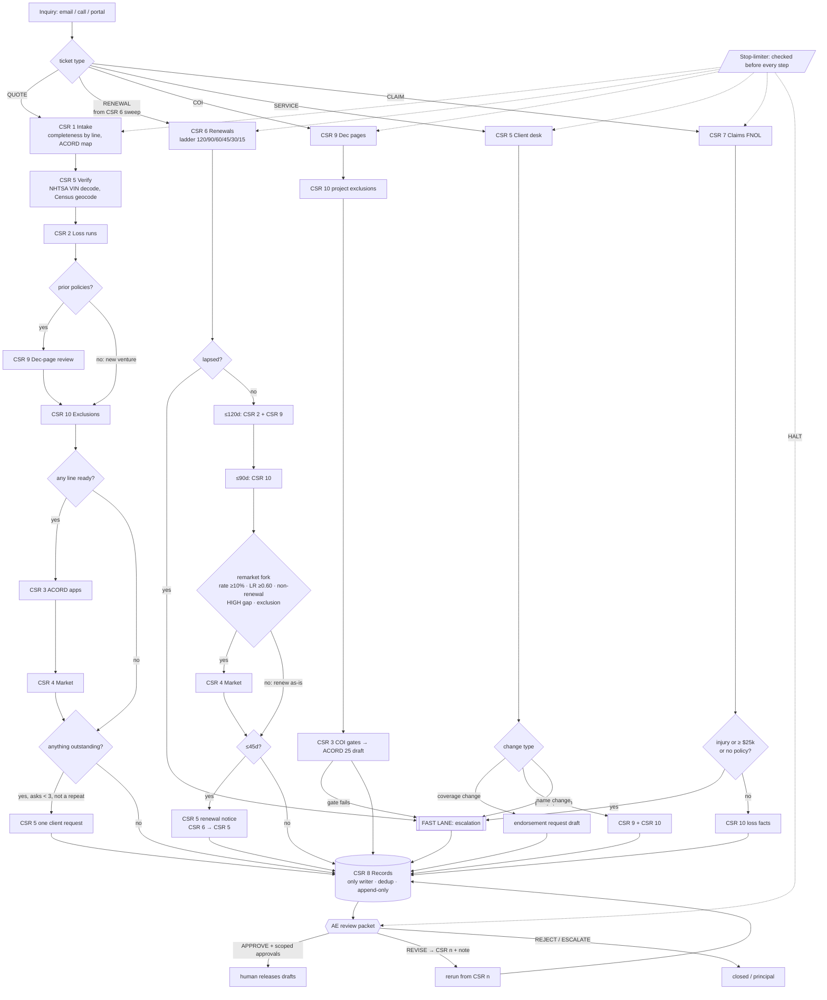

# Agency CSR Desk: Architecture

Ten CSR agents and an AE feedback loop for a commercial-lines agency. The goal is that the AE opens one
packet per ticket, sees what is on fire first, and approves, sends back or rejects in a minute. CSRs
can use the same desk: every step a CSR does by hand here is a step they can check instead of type.

**One rule underneath everything: the model routes and writes; the engine computes and decides.**
Completeness, dates, limits, loss math, renewal timing, caps and every routing branch live in code
(`engine/csrdesk`, Python 3.9 standard library). Agents do the parts that need language: reading a dec-page
PDF, judging a carrier's appetite, and wording an email. Every agent output passes a schema gate, and every
figure in prose passes a grounding gate.

## 1. The workflow



Two kinds of connection, kept separate on purpose:

- **Control is hub-and-spoke.** Only the router (`routing.py`) moves a ticket from one agent to the next,
  and it records a rule id for every move. This is what makes the stop-limiter enforceable and the trail
  auditable.
- **Messaging is a mesh.** Every CSR can NOTIFY, REQUEST or REPLY to every other CSR and the AE
  (`schemas.check_message`). Messages inform; they never move control. CSR 2 telling CSR 4 about a large
  loss does not make CSR 4 run (there's a test for that).

Ten agents freely handing work to each other is 90 directed channels with no owner. That is how agent
teams loop forever. "All in communication" here means everyone can talk; one place decides.

## 2. The agents

| # | Agent | Owns | Engine does (code) | Model does (subagent) |
|---|---|---|---|---|
| 1 | Intake | quote inquiries | completeness per line (`REQUIRED_BY_LINE`), blocking vs non-blocking gaps, ACORD form map, umbrella underlying check | turn an email into a ticket; propose NAICS from the description |
| 2 | Loss runs | loss history | status per line (current / stale >90d / short of 5 policy terms / missing / new venture / new line), incurred, loss ratio (only when premium covers the window), large losses ≥ $25k, carrier request letters + LOA ask | transcribe carrier loss-run PDFs |
| 3 | COI & ACORD | certificates, applications | COI gates in order (policy in force → dec reviewed → no HIGH gap → no CRITICAL exclusion), ACORD 25 field set with AI/WOS = Y only where endorsed; ACORD 125/126/127/129/130/131/140 field sets | map field sets into the agency's licensed forms/AMS |
| 4 | Market | carrier research, go-to-market | hard filters from the agency appetite file (line, state, NAICS, revenue band, AM Best ≥ A-, verified ≤ 365 days), weighted total, floor 60, cap 5 | five 0-5 judgments per eligible carrier, cited |
| 5 | Client desk | everything the client sees or supplies | VIN check digit → NHTSA decode → ISO size class (unresolved if the GVW band straddles a class); Census geocode; one consolidated, deduped request (max 3); renewal notice; service-change if/else | wording |
| 6 | Renewals | the book | sweep at ≤120 days; rungs due; **NOTIFY CSR 5 at 45 days**; remarket fork; lapsed → escalate | none needed |
| 7 | Claims | FNOL | policy in force on date of loss; URGENT (injury or ≥ $25k); late notice (>30 days); ACORD 1/2/3 FNOL draft; NOTIFY CSR 6, 2, 8 | intake from a phone note |
| 8 | Records | the database | the **only writer**: masked account, FEIN as a hash, dedup FEIN → name+ZIP, append-only events (DB triggers) | reconcile conflicts for the AE |
| 9 | Dec pages | what coverage says | limit shortfalls (with umbrella check), AI/WOS/PNC endorsement presence by ISO form number or phrase, claims-made flag; missing dec → request, never "looks fine" | PDF → structured dec page |
| 10 | Exclusions | what coverage removes | review prompts by operation (landscaper: pollution, snow; contractor: residential, action-over, subcontractor; restaurant: assault & battery, liquor) and by loss facts; residential exclusion on a residential COI → CRITICAL | read the actual form wording |
| AE | Account executive (human) | decisions | the packet, ordered: escalations → halts → drafts awaiting release → outstanding | ae-briefer explains and writes the decision JSON |

## 3. if/else, all of it in code

Every branch is in `routing.py` (between agents) or in the worker (inside a desk). Rule ids appear in the
packet and the audit log.

**Global forks**
- **F-1 escalate:** any step returns `escalate`, so the ticket skips the remaining steps (except *essential*
  instant checks, such as CSR 10/9 on a claim), CSR 8 records, and the AE gets it now.
- **F-2 plan complete:** CSR 8 records, then AE review.

**QUOTE:** R-Q1 intake → R-Q2 verify *if* vehicles or addresses → R-Q3 loss runs → R-Q4 dec review *if* prior
policies (else a new venture) → R-Q5 exclusions → R-Q6 ACORD apps *if* at least one line ready → R-Q7 market *if*
at least one line ready → R-Q8 client request *if* anything is outstanding.

**RENEWAL:** R-R1 ladder → *if lapsed* fast lane → R-R2/R-R3 loss runs + dec page *if* ≤120d → R-R4 exclusions *if*
≤90d → R-R5 market *if* ≤90d **and** the remarket fork holds → R-R6 client notice *if* ≤45d → R-R7 client request *if*
anything is outstanding.

**COI:** R-C1 dec review → R-C2 exclusions *if* a project is named → R-C3 COI gates (first failure escalates:
no policy in force · dec not reviewed · requirement exceeds dec · critical exclusion).

**SERVICE:** coverage change → endorsement request (AE approves submission); add driver needs license, DOB
**and signed MVR consent** first; add vehicle → VIN decoded first; policy question → CSR 9 + 10 → AE (CSR 5
never interprets coverage); name change → AE (new entity = new insured); address/billing → CSR 5
confirmation.

**CLAIM:** no policy on the date of loss → AE as a coverage question (the client is never told "not
covered") · injury or ≥ $25k → URGENT · reported >30 days late → late-notice flag · otherwise FNOL draft.

## 4. Stop-limiters

Checked before every step (`limiter.py`). A halt is never a silent stop. CSR 8 records the ticket and the
AE gets the packet with the reason. All numbers live in `thresholds.py`.

| Code | Trips when | Why it exists |
|---|---|---|
| KILL_SWITCH | `data/runtime/STOP` exists | the agency can stop everything in one move |
| WALL_CLOCK | ticket older than its SLA: COI 4h · claim 2h · service 24h · quote 72h · renewal 30d | a stuck ticket becomes a person's job, not an agent's loop |
| MAX_HOPS | > 40 steps | the absolute ceiling |
| STEP_REVISIT | one step runs > 4 times (1 + 3 revisions) | rework without progress |
| PING_PONG | the last 6 steps alternate between two agents | the classic two-agent loop |
| MESSAGE_STORM | > 80 bus messages | a loop that talks instead of acts |
| CLIENT_ASK_CAP | a 4th info request to the client | after three emails, the AE calls; identical repeat lists are deduped and never count |
| BUDGET | > 40 outside calls / 12 writes per ticket (spine S9) | cost runaway |
| AE_REVISION_CAP_CSR / _TOTAL | > 3 send-backs to one CSR / > 6 per ticket | the AE↔CSR loop needs a conversation, not another revision |

## 5. The AE feedback loop

`bin/csr decide <ticket> <decision.json>`:

- **APPROVE** with scoped approvals (`"issue_coi:C-2001/0"`): one approval, one action, one draft (spine S8).
  `bin/csr release` still denies while `live` is false. Drafts-only is the default.
- **REVISE → CSR n + note:** the engine reruns that CSR's step and everything after it, the note travels to
  the CSR, CSR 8 re-records, and the AE gets a fresh packet. Optionally with updated ticket data ("dec page
  attached").
- **REJECT / ESCALATE:** closed, or sent up to the principal.
- **Client replies** come back through `bin/csr refresh`. Same ticket, new data, rerun from intake, with
  counters carried over so refreshes can't loop forever.

## 6. Guardrails that are code

- **IRREVERSIBLE acts** (`policy.py`): bind, issue, certify, submit, endorse, cancel, non-renew, file a claim,
  pay, pull an MVR or credit report, send, plus anything unrecognised (fail closed). Each needs the AE's
  approval scoped to `<tool>:<ticket>/<draft>`.
- **Grounding gate** on every draft: one figure not traceable to the record or computed output and the
  draft is discarded whole. A model can't round a $1M limit into "$2M".
- **Schema gate** on every record; a model can't supply a total, tier, score, rank or age (spine S2).
- **PII**: license numbers and DOBs (DPPA), FEINs (GLBA) are masked at intake. The FEIN is stored only as a
  hash. A test proves no raw value reaches run state, the DB or the audit log.
- **Honest degradation**: no appetite file → `needs_key`, not carriers from memory; NHTSA/Census down →
  `unavailable`, not an empty schedule; unknown premium history → loss ratio `None`, not a ratio over the
  wrong window.
- **Audit**: hash-chained JSONL per ticket; an edited line breaks `bin/csr audit`.
- **Spine conformance**: the shared spine-spec v1.1.0 vectors (63/63) run in the test suite against the
  production gates, plus tests proving that breaking a gate turns its vectors red.

## 7. Improvements I'd make (AE-to-engineer view)

These are changes to the workflow as specified, ordered by how much AE time they save. The ones marked
*built* are already in this repo.

1. **Start renewals at 120 days, not 45.** *Built:* the 45-day CSR 6 → CSR 5 hand-off is kept exactly as
   specified, but the ladder starts loss runs and the dec-page baseline at 120, exclusions and the remarket
   decision at 90, submissions at 60. Commercial markets often need weeks to quote. A remarket that starts at
   45 days lands on the AE's desk at day 10.
2. **Hub-and-spoke control, mesh messaging.** *Built.* "All in communication" without a single router is how
   agent teams loop and how nobody can say why a ticket went where it did.
3. **CSR 8 as the only writer.** *Built.* Ten agents half-updating one record is the duplicate-insured problem
   every AMS already has.
4. **One client voice.** *Built:* every CSR's questions merge into one CSR 5 email, deduped, max three. Clients
   who get four emails from four CSRs stop answering.
5. **Add CSR 11, policy checking.** The ten roles skip the biggest E&O control in an agency: comparing the
   issued policy against the proposal and binder. It reuses CSR 9's dec-page parser: proposal limits, forms
   and endorsements vs the policy as issued, with every mismatch sent to the AE before the policy goes to the
   client.
6. **A certificate-holder library.** Repeat holders (property managers, GCs) send the same requirements every
   time. Store them per holder; a COI request from a known holder runs the gates with no CSR touch.
7. **Merge CSR 9 + CSR 10 output into one coverage review for the AE.** They stay separate agents (different
   skills), but the AE should read one gap list, not two.
8. **Premium-audit prep (WC/GL).** 60 days before audit, CSR 5 collects payroll and sales by class, so the
   audit doesn't produce a surprise bill.
9. **Wire the AMS and the carrier side.** CSR 8 to Applied Epic / HawkSoft / EZLynx / QQCatalyst /
   NowCerts through a connector (writes are classified WRITE). Carrier download and status through IVANS or the
   carrier portals (all submit/endorse/file tools are IRREVERSIBLE).
10. **Measure, then claim.** Log turnaround per ticket type and AE touches per ticket from the audit trail
    before stating any time saved. The trail already carries the timestamps.

## 8. Production readiness

```
PRODUCTION READINESS — agency CSR desk
1. Clear Goal .............. ✅  one job per CSR, testable outputs; AE packet is the success surface
2. Trusted Tooling ......... ⚠️  NHTSA + Census real and tested; AMS, carrier portals, email not wired (drafts only)
3. Strong Context/Memory ... ✅  ticket state persisted per ticket; outputs of earlier steps feed later ones
4. Guardrails/Approvals .... ✅  schema, grounding, fork, scoped approval, PII masking, fail-closed classifier
5. Evaluation/Testing ...... ⚠️  151 tests incl. 63 spine vectors, on SAMPLE data; no real-book replay yet
6. Observability/Audit ..... ✅  hash-chained audit per ticket; rule id on every routing decision
7. Orchestration ........... ✅  explicit state machine, retries with backoff on outside calls, fast lane
8. Human Oversight ......... ✅  every IRREVERSIBLE act needs the AE; halts go to a human with context
9. Cost/Token Bounds ....... ✅  hop, visit, ping-pong, message, budget, revision and wall-clock caps

VERDICT: NEEDS WORK, for production. It's ready to run as a drafts-only desk on real tickets.
Top fixes: (1) load the agency's appetite guide into data/appetite.csv; (2) wire CSR 8 to the AMS;
(3) replay 20 closed tickets from the real book through it and compare against what the CSRs did;
(4) encode the state-specific rules the agency writes in (cancellation/non-renewal notice periods) as
thresholds before CSR 6 drafts anything about them.
```

## 9. What this is not

- It doesn't bind, issue, file, submit or send. Drafts only, until the agency sets `live` and the AE grants a
  scoped approval per act.
- It doesn't interpret coverage. CSR 9 and CSR 10 report what documents show; the AE and the carrier decide.
- It doesn't produce ACORD forms. ACORD forms are licensed. The desk produces field data for the agency's
  licensed forms or AMS.
- It doesn't recommend carriers from memory. No appetite file, no market list.
